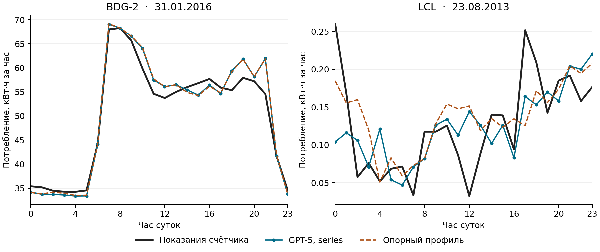

# Суточный прогноз электропотребления зданий с помощью GPT-5 и моделей временных рядов

## Аннотация

Мы сравнили прогнозы одиночного агента GPT-5 с прогнозами моделей временных рядов в задаче прогноза почасового электропотребления на следующие сутки. Выборка включала 100 зданий из BDG-2 и Low Carbon London (LCL), по два тестовых окна на здание. Каждый прогноз строился по 336 часам истории. Нормированную среднеквадратичную ошибку (NRMSE) усредняли внутри здания и затем брали медиану по зданиям. Агент с инструментами анализа ряда показал 8,71% на BDG-2 и 70,65% на LCL. На BDG-2 сопоставимую медиану дало повторение предыдущих суток (8,78%). В дополнительном сравнении медианный профиль будня или выходного, доступный самому агенту, дал 12,13% на BDG-2 и 63,79% на LCL. На обоих наборах интервалы парного отношения ошибок агента с инструментами и GPT-5 с рядом в сообщении включали единицу. Минимальные медианы на 200 основных окнах получены у Chronos-2 (7,55% и 54,42%). В конфигурации с доступом к внешним источникам агент запрашивал погоду на всех окнах и ни разу не воспользовался поиском новостей. В отдельном пилоте мультиагентная система сформировала допустимый прогноз на каждом из двух отладочных окон.

**Ключевые слова:** прогнозирование электропотребления, временные ряды, большие языковые модели, LLM-агент, мультиагентная система, GPT-5, NRMSE.

## 1. Введение

В суточном прогнозе для здания важно, в какие часы возникает нагрузка. Два прогноза с одной и той же суммой кВт·ч по-разному опишут утренний подъём и вечерний максимум, если один из них сдвигает пик на несколько часов. Простейший прогноз на понедельник повторяет воскресный профиль. Прогноз по предыдущему понедельнику сохраняет день недели, но может хуже отражать недавнее изменение уровня потребления. Суточную и недельную сезонность совместно учитывали уже в классических моделях краткосрочного спроса на электроэнергию [1]. В задаче с историей в две недели выбор между этими ориентирами особенно ощутим: для каждого часа есть 14 наблюдений, из них лишь два приходятся на тот же день недели.

Масштаб измерения также влияет на интерпретацию ошибки. Sevlian и Rajagopal на данных интеллектуальных счётчиков показали, как при объединении потребителей меняется относительная ошибка прогноза [2]. Измерение одного домохозяйства сохраняет колебания, которые сглаживаются в суммарной нагрузке. В работе Kong и соавторов для прогноза отдельного домохозяйства использовались в том числе последовательности потребления приборов [3]. В наших данных доступно суммарное почасовое показание счётчика. Поэтому на двух наборах мы отдельно оцениваем, насколько далеко позволяет продвинуться одна история потребления и что добавляет доступный агенту контекст.

Для языковой модели задача допускает несколько решений. GPT-5 может прочитать 336 показаний непосредственно, запросить готовый суточный профиль или собрать собственный прогноз по нескольким профилям. В последнем случае часть работы уже выполнил инструмент. Нас интересуют три эмпирических вопроса. Как ошибка агента соотносится с сезонными ориентирами и специализированными моделями временных рядов? Как меняются точность и стоимость при переходе от исходных чисел к инструментам и внешним данным? Наконец, как часто итоговые 24 значения оказываются ближе к фактическому потреблению, чем один из профилей, уже показанных агенту? Последний вопрос возник при разборе результатов и исследуется отдельно. Для системы с координатором и двумя специалистами приводим результаты пилота.

## 2. Связанные работы

### 2.1. Прогноз нагрузки здания и предобученные модели

В BuildingsBench исследуется перенос моделей, обученных на большом корпусе синтетических рядов, на реальные коммерческие и жилые здания. Авторы отдельно оценивали применение модели с готовыми весами и дообучение на целевом здании [4]. В нашей постановке каждое новое окно даёт модели только две недели истории данного объекта. Поэтому, кроме методов с готовыми весами, в сравнение включены профили прошлых суток и недели, среднее по нескольким дням и локальные модели, параметры которых оцениваются по этому окну.

Предобучение на временных рядах тоже допускает разные способы представления данных. В исходной работе Chronos значения масштабируются и квантуются, после чего модель учится прогнозировать последовательность числовых токенов [5]. В семействе TimesFM модель получает фрагменты ряда и обучается предсказывать его продолжение [6]. Chronos-2 позволяет работать также с несколькими рядами и внешними признаками [7]. Мы оцениваем конкретные версии Chronos-Bolt, Chronos-2 и TimesFM 2.5 в одномерном режиме. Такое сравнение показывает, какую точность на тех же окнах дают готовые модели, если им передать только потребление.

### 2.2. Языковая модель как прогнозист

Gruver и соавторы показали, что числовой ряд можно закодировать текстом и получить прогноз как его продолжение [8]. Для задачи электропотребления Xue и Salim преобразовывали наблюдения в текстовые описания и дообучали модели на данных зданий Мельбурна [9]. Chen и соавторы в работе Ele-LLM сравнили несколько языковых моделей и вариантов запроса для сверхкраткосрочного прогноза нагрузки, а затем исследовали специализированную модель с дообучением LoRA [10]. В нашем эксперименте веса GPT-5 фиксированы. По одному и тому же окну мы меняем способ доступа к данным и сохраняем как прогноз, так и последовательность вызванных инструментов.

Tan и соавторы исследовали вклад языкового компонента в трёх обучаемых архитектурах прогноза рядов. В их экспериментах после замены или удаления этого компонента точность часто сохранялась либо возрастала [11]. Для агента с инструментами возникает близкий методический вопрос. Даже простой инструмент способен вернуть все 24 прогнозных значения. Поэтому мы сопоставляем ответ агента с готовым профилем будня или выходного и измеряем расстояние между двумя прогнозами. Это позволяет оценить результат выбора модели, даже когда её окончательный ответ очень похож на один из входов.

### 2.3. Внешний контекст и роль агента

В бенчмарке Context is Key текст описывает условия, существенные для будущей траектории ряда [12]. В задаче нагрузки известная дата праздника и прогноз температуры имеют разную природу. Первое условие задано календарём, второе само содержит ошибку. Кроме того, при свободном выборе инструментов агент может вообще не запросить источник. Поэтому для интерпретации эксперимента нужны как ошибки конфигураций, так и число окон, в которых модель действительно обращалась к каждому источнику.

В ReAct модель выбирает действие и получает наблюдение из внешней среды [13]. В AutoGen несколько агентов могут обмениваться сообщениями и результатами работы [14]. Применительно к прогнозу зданий Li и соавторы предложили AutoLFM, где специализированные агенты автоматизируют разработку прогнозирующей модели, включая генерацию и проверку кода [15]. У нас роль модели иная. На каждом окне одиночный GPT-5 или координатор сам сдаёт 24 почасовых значения. Следовательно, время и токены расходуются при каждом прогнозе. Сравнивать такие системы имеет смысл с учётом того, какую часть работы они выполняют заново для следующих суток.

## 3. Данные и экспериментальная выборка

### 3.1. Источники

Из BuildingsBench [4] взяты почасовые ряды BDG-2 [16] и Low Carbon London (LCL) [17]. В тестовую выборку BDG-2 вошли 13 коммерческих и общественных зданий площадки Bear, 17 площадки Fox, 9 площадки Panther и 11 площадки Rat. В исходном проекте LCL показания снимались каждые полчаса у 5 567 лондонских домохозяйств [17]. Здесь использованы почасовые ряды из версии BuildingsBench, из них 50 домохозяйств вошли в тест. Прогнозируемая величина в обоих наборах — энергия в кВт·ч за час. Масштабы потребления существенно различаются. Если для каждого тестового объекта усреднить потребление в истории двух основных окон, медиана этих средних равна 82,00 кВт·ч за час для BDG-2 и 0,19 для LCL.

| Набор | Период выбранных рядов | Тестовые здания | Здания dev | Все test-окна | Основные test-окна | Dev-окна |
| --- | --- | ---: | ---: | ---: | ---: | ---: |
| BDG-2 | 2016–2017 | 50 | 5 | 200 | 100 | 20 |
| LCL | 2012–2013 | 50 | 5 | 200 | 100 | 20 |
| Всего | — | 100 | 10 | 400 | 200 | 40 |

### 3.2. Отбор и качество данных

Из отбора исключали ряды с пропусками, долей нулевых значений от 1% и длительными постоянными участками. Четыре или более последовательные точки на прямой считали признаком возможной интерполяции. Ряд допускали, если доля таких отсчётов составляла менее 1%. В прогнозной части окна таких отсчётов не должно было быть, а в истории допускалось до 2%. Для LCL дополнительно требовалось не менее 8 000 почасовых наблюдений за выбранный год при среднем потреблении не ниже 0,05 кВт·ч за час.

Для каждого здания использовали данные одного года. При отборе коммерческих объектов учитывали площадку и назначение здания. Здания из отладочной выборки не входят в тестовую. Временные метки BDG-2 заданы в местном стандартном времени, а метки LCL приведены к GMT.

### 3.3. Прогнозные окна

Каждое окно включает 336 последовательных часов истории и следующие 24 часа с полуночи. Для каждого тестового здания подготовлены четыре непересекающихся окна разных типов. Праздники определяли по календарю страны и региона. Для выделения погодных аномалий рассчитывали абсолютное отклонение среднесуточной температуры от центрированного 31-дневного среднего. К аномальным относили дни с отклонением не ниже 95-го процентиля за период выбранного ряда. Разметку использовали для отбора окон и анализа ошибок.

День с несколькими признаками относили к одной категории. Приоритет имел праздник, затем погодная аномалия, затем деление на обычные будни и выходные. Центрированное температурное среднее использовалось только при ретроспективной разметке. Метку типа окна агенту не сообщали. Для основного сравнения оставили по одному обычному и одному особому дню на здание. Чередование типов по списку зданий дало следующее распределение.

| Тип прогнозируемых суток | BDG-2 | LCL | Всего |
| --- | ---: | ---: | ---: |
| Будний день | 25 | 25 | 50 |
| Выходной | 25 | 25 | 50 |
| Праздник | 26 | 26 | 52 |
| Погодная аномалия | 24 | 24 | 48 |

Классические модели рассчитаны на всех 400 тестовых окнах. В общих сравнительных таблицах используются их результаты на тех же основных 200 окнах.

## 4. Сравниваемые методы

### 4.1. Классические и предобученные модели

Для каждого окна строится прогноз на 24 часа по 336 часам истории. Параметры классических методов фиксированы для всех окон. LightGBM обучается отдельно на истории каждого окна. Предобученные модели применяются с готовыми весами.

| Метод | Построение прогноза |
| --- | --- |
| Seasonal naive 24 | Повторение последних 24 часов истории |
| Seasonal naive 168 | Повторение соответствующих часов предыдущей недели |
| Persistence Ensemble | Среднее потребление в соответствующий час за семь предыдущих суток |
| AutoETS | Автоматический выбор модели экспоненциального сглаживания с периодом сезонности 24 часа |
| MSTL | Разложение с периодами 24 и 168 часов, прогноз тренда с помощью AutoETS (`ZZN`) |
| LightGBM | Регрессия по лагам 24, 48, 72 и 168 часов, среднему по 24 часам с лагом 24 часа, часу суток, дню недели и признаку праздника |
| LightGBM с погодой | Те же признаки и температура воздуха |
| AutoML | Выбор одного из шести классических методов по ошибке ретроспективного прогноза |
| Chronos-Bolt | Медиана прогнозного распределения, веса [`amazon/chronos-bolt-base`](https://huggingface.co/amazon/chronos-bolt-base) |
| Chronos-2 | Медиана прогнозного распределения, веса [`amazon/chronos-2`](https://huggingface.co/amazon/chronos-2) |
| TimesFM 2.5 | Точечный прогноз модели, веса [`google/timesfm-2.5-200m-pytorch`](https://huggingface.co/google/timesfm-2.5-200m-pytorch) |

Для AutoETS и MSTL используется StatsForecast. В обеих конфигурациях LightGBM применяются 200 деревьев, скорость обучения 0,05, до 15 листьев на дерево и значение параметра `min_child_samples`, равное 10. Зерно генератора случайных чисел равно 0. Минимальный лаг составляет 24 часа, поэтому признаки для всех прогнозируемых часов вычисляются из значений, доступных к началу прогноза. Погодная конфигурация получает наблюдавшуюся температуру за период истории и тот же синтетический прогноз температуры, что и одиночный агент `weather` (§ 5.1).

В AutoML сравниваются два сезонных наивных метода, Persistence Ensemble, AutoETS, MSTL и LightGBM без погоды. Последние двое суток истории по очереди используются для проверки. Для каждого из этих дней 24-часовой прогноз строится по данным до его начала. Метод с наименьшей средней MAE за два дня затем строит прогноз по полной истории окна.

На вход Chronos-Bolt, Chronos-2 и TimesFM 2.5 подаётся только ряд электропотребления. Прогоны выполнены на CPU с Python 3.11.0, NumPy 2.4.6, pandas 2.2.2 и PyTorch 2.14.1+cpu. Для обеих моделей Chronos использовался пакет `chronos-forecasting` 2.3.2. В журналах классических прогонов версии StatsForecast и LightGBM отсутствуют. Версия реализации TimesFM также не зафиксирована. Отрицательные прогнозы заменяются нулём. При сбое на отдельном окне применяется прогноз «как вчера», случай фиксируется в журнале прогона.

В GIFT-Eval Pretrain есть ряды BDG-2 и Low Carbon London. Этот корпус указан в карточке TimesFM 2.5. Chronos-2 использует подмножества GIFT-Eval Pretrain и Chronos Datasets. Авторы Chronos-2 исключили тестовые части задач GIFT-Eval из обучения. В нашей работе окна отобраны самостоятельно. Для Chronos-Bolt состав данных с детализацией до рядов BDG-2 и LCL в карточке модели не приведён. По опубликованным сведениям участие конкретных тестовых окон в предобучении установить нельзя. Результаты этих моделей оценивают применение готовых весов на выбранных рядах. [GIFT-Eval Pretrain](https://huggingface.co/datasets/Salesforce/GiftEvalPretrain/tree/main) · [Chronos-2, § 4 и § 5.1](https://arxiv.org/html/2510.15821) · [Карточка TimesFM 2.5](https://huggingface.co/google/timesfm-2.5-200m-pytorch)

### 4.2. Одиночный LLM-агент

Одиночный агент использует GPT-5 с параметром `reasoning_effort=low`. Модель задаёт аргументы инструмента и получает ответ в следующем сообщении диалога. Для завершения модель вызывает `submit_forecast` с 24 конечными неотрицательными значениями. Если получить допустимый прогноз в пределах бюджета вызовов не удаётся, система сохраняет профиль предыдущих суток и помечает окно как сбой.

| Конфигурация | Доступная информация |
| --- | --- |
| no_tools | 336 часов истории в сообщении, сдача через submit_forecast |
| series | Дата прогноза, день недели, инструменты анализа ряда и опорные профили |
| calendar | Дополнительно сведения о праздниках и обезличенные характеристики здания |
| weather | Дополнительно историческая и будущая температура с моделью ошибки |
| full | Дополнительно город и исторические новости |

Во всех пяти основных конфигурациях GPT-5 видит дату прогноза и день недели. В `no_tools` модель читает почасовые значения прямо в сообщении. В `series` она может запросить значения и рассчитанные по ним профили. Режим `calendar` добавляет сведения о праздниках и объекте, а `full` открывает доступ к названию города и поиску новостей. Итоговая ошибка характеризует всю конфигурацию. Фактическое использование инструментов приведено в § 6.2.

### 4.3. Мультиагентная система

В мультиагентной системе координатор последовательно поручает анализ специалистам. Каждому специалисту выделен отдельный диалог со своим набором инструментов. Специалист возвращает текстовый отчёт с числовыми аргументами. При повторном обращении система возвращает сохранённый отчёт. Координатор получает отчёты всех доступных специалистов и формирует итоговые 24 значения потребления с 00:00 до 23:00. Во всех ролях используется GPT-5 с уровнем рассуждений `low`.

| Роль | Доступ и задача | Конфигурации |
| --- | --- | --- |
| Аналитик ряда | Статистики, значения истории, опорные профили | Все |
| Независимый проверяющий профилей | Статистики и профили, оценка рисков экстраполяции | Все |
| Аналитик календаря | Календарь и метаданные здания | calendar, weather, full |
| Аналитик погоды | Температура, статистики потребления и профили | weather, full |
| Аналитик новостей | Исторические новости и сведения о здании | full |

В режиме `series` работают аналитик ряда и проверяющий профилей. Аналитик оценивает изменение нагрузки за две недели и сопоставляет профиль предыдущих суток, профиль того же дня прошлой недели и типичные профили будней и выходных. Проверяющий отдельно оценивает, какие профили подходят для прогнозируемых суток. Например, при прогнозе на понедельник воскресный профиль характеризует недавний уровень нагрузки, а профили предыдущих понедельников отражают её недельную периодичность. Координатор использует обе оценки при подготовке прогноза.

В пилоте координатору отводилось до восьми вызовов GPT-5, каждому специалисту до пяти. Если специалист успел получить данные, последний доступный вызов выделялся на подготовку отчёта. Для итогового прогноза действуют те же требования к числу и допустимости значений, что и у одиночного агента. При сбое система сохраняет профиль предыдущих суток и отмечает окно в журнале.

## 5. Протокол оценки

### 5.1. Общие условия и настройки

Все системы получают только историю соответствующего окна и разрешённый для конфигурации контекст. Правильные значения прогнозируемых суток используются для расчёта ошибки после сдачи прогноза. Идентификаторы зданий перед предъявлением LLM обезличиваются.

Для будущей температуры применяется синтетическая модель ошибки AR(1) с коэффициентом 0,9. Базовое стандартное отклонение увеличивается от 1 до 2 °C в пределах суток, с дополнительными множителями ночью и зимой. Погодные варианты агента и LightGBM используют одинаковое зерно генерации. При запросе новостей инструмент `full` выбирает историческую ревизию, доступную за час до начала прогноза, с учётом местного смещения относительно UTC.

Ход одного прогноза удобно проследить на примере понедельника. К полуночи доступны 14 полных суток истории, включая воскресенье и два предыдущих понедельника. В `no_tools` все почасовые значения помещены в сообщение. В `series` модель может получить воскресный профиль, профиль прошлого понедельника, среднее двух предыдущих понедельников и почасовые медианы будней и выходных. Статистики ряда показывают, в частности, как изменился средний уровень между первой и второй неделями. Агент сам решает, какие сведения запросить и какие значения передать в `submit_forecast`. Для оценки сохранённого ответа используются показания с 00:00 до 23:00 прогнозируемого дня. На каждом окне в основную оценку входит один запуск конфигурации. Настройки и хеши кода и окон сохранены в `run_config.json`.

В тестовом прогоне одиночного агента использован идентификатор API `gpt-5` и лимит 20 шагов на окно. Журнал конфигурации фиксирует переданный идентификатор, по которому нельзя установить точный снапшот модели.

### 5.2. Общие условия одиночного агента и мультиагентного пилота

В режиме `series` обе системы используют GPT-5 с уровнем рассуждений `low`. Им известны дата и день недели. Они могут запрашивать 336 часов потребления одного здания, статистики ряда и опорные суточные профили. Инструменты для получения сведений о праздниках, температуре и новостях в этом режиме отключены.

Одиночный агент прошёл все 200 основных тестовых окон. Для мультиагентной системы доступны два запуска на отладочных зданиях. В пилоте учитывали число вызовов модели, входные и выходные токены, время и случаи перехода к резервному прогнозу. Разные окна и бюджеты вызовов ограничивают интерпретацию этих затрат (§ 6.3).

### 5.3. Метрика и статистика

Для окна с 24 целевыми значениями используется

$$
\mathrm{NRMSE}=\frac{\sqrt{\frac{1}{24}\sum_{h=1}^{24}(\hat y_h-y_h)^2}}
{\frac{1}{336}\sum_{t=-336}^{-1}y_t}\cdot100\%.
$$

Знаменатель NRMSE задаётся до начала прогноза и одинаков для всех методов на данном окне. Ошибка в 1 кВт·ч получает разный вес для домохозяйства и для крупного здания. Квадрат отклонения придаёт больший вес крупным почасовым промахам. Если прогноз правильно воспроизводит суточную сумму, но сдвигает максимум на час, ошибка возникает и в час фактического пика, и в час прогнозируемого. Это соответствует постановке задачи как прогноза всего суточного профиля.

Для каждого здания мы усредняли NRMSE его двух окон, затем брали медиану по 50 зданиям каждого набора. Для парного сравнения на каждом окне рассчитывали логарифм отношения ошибок двух методов. Сначала усредняли его внутри здания, затем по зданиям. Экспонента этого среднего даёт отношение ошибок, указанное далее. Значение ниже единицы означает меньшую ошибку метода в числителе. Для сравнений одиночного агента 95%-й интервал получали по процентилям 2 000 бутстреп-выборок из 50 зданий с возвращением (зерно 0). Двусторонний критерий знаковых рангов Уилкоксона применяли к средним логарифмам отношений по зданиям.

Поправку Холма рассчитывали внутри каждого семейства. Для одиночного агента выполнены 88 проверок: четыре соседние пары конфигураций и пять конфигураций в сравнении с каждым из восьми классических методов на двух наборах данных. Каждая пара учитывалась один раз. Дополнительное сравнение `series` с медианным профилем будня или выходного выбрано после просмотра тестовых результатов. Две проверки этой пары образуют отдельное семейство. Доверительные интервалы приведены без поправки на множественные сравнения. Интервал описывает неопределённость среднего логарифма отношения, а ранговый тест учитывает знаки и ранги различий. Поэтому его результат может отличаться от вывода по интервалу.

Для предобученных моделей автор расчёта выделил семейство из 16 проверок. Три модели сопоставлены с Seasonal naive 24 и Persistence Ensemble, а Chronos-2 также с Chronos-Bolt и TimesFM 2.5, отдельно на каждом наборе данных. В приложении приведены исходные и скорректированные значения *p* для всех 16 проверок. [Таблица парных сравнений](supplement/comparisons_test_main_200.csv)

## 6. Результаты

### 6.1. Основное сравнение подходов

В таблице приведены медианы NRMSE по зданиям на общих 200 тестовых окнах. Медианный профиль будня или выходного воспроизводит одно из правил, доступных агенту через `reference_profiles`. Для каждого часа понедельника–пятницы берём медиану этого часа по будням предыдущих двух недель, для субботы и воскресенья — по выходным. День недели известен до начала прогноза. Правило применяется и к праздникам, и к погодным аномалиям.

| Метод | BDG-2, NRMSE % | LCL, NRMSE % |
| --- | ---: | ---: |
| Одиночный GPT-5, series | 8,71 | 70,65 |
| Медианный профиль будня или выходного | 12,13 | 63,79 |
| Seasonal naive 24 | 8,78 | 84,89 |
| Seasonal naive 168 | 13,95 | 88,95 |
| Persistence Ensemble | 11,19 | 66,20 |
| AutoETS | 12,45 | 73,56 |
| MSTL | 13,18 | 75,73 |
| LightGBM | 10,50 | 70,09 |
| LightGBM с погодой | 9,35 | 68,26 |
| AutoML | 10,34 | 68,23 |
| Chronos-Bolt | 8,16 | 59,88 |
| Chronos-2 | 7,55 | 54,42 |
| TimesFM 2.5 | 8,96 | 58,85 |

По журналам восьми классических моделей и сводке трёх предобученных моделей все 11 методов завершили по 400 окон без замены результата резервным прогнозом. Для предобученных моделей медианы на 200 и 400 окнах и число сбоев приведены на листах «Для статьи» и «Прогоны». [Сводка соавтора](supplement/foundation_baselines_test.xlsx)

Среди восьми исходных классических методов на BDG-2 минимальная медиана получена у Seasonal naive 24, на LCL — у Persistence Ensemble. Добавление температуры к LightGBM снижало медианную NRMSE с 10,50 до 9,35% на BDG-2 и с 70,09 до 68,26% на LCL.

На общих 200 окнах у Chronos-2 наименьшая медианная NRMSE среди представленных методов на обоих наборах данных. В парном сравнении на BDG-2 отношение NRMSE Chronos-2 к Seasonal naive 24 составило 0,826 (95% ДИ 0,742–0,941, \(p_{\mathrm{Holm}} < 0{,}001\)). На LCL отношение NRMSE Chronos-2 к Persistence Ensemble составило 0,760 (95% ДИ 0,665–0,854, \(p_{\mathrm{Holm}} < 0{,}001\)). Каждое отношение рассчитано по 50 зданиям. При расширении оценки до всех 400 окон на LCL минимальная медиана среди предобученных моделей получена у TimesFM 2.5 (62,38% против 63,88% у Chronos-2).

На BDG-2 медиана одиночного агента `series` ниже медианы Seasonal naive 24 на 0,06 п. п. по значениям до округления. Парное отношение ошибок агента к Seasonal naive 24 составило 1,002 (95% ДИ 0,875–1,153). На LCL медиана агента выше медианы Persistence Ensemble на 4,45 п. п., а парное отношение составило 0,980 (0,877–1,077). Обе пары дают интервалы, включающие единицу. Разность медиан и среднее отношение внутри зданий описывают разные свойства распределения ошибок.

При сравнении с готовым медианным профилем на BDG-2 медиана ошибки агента ниже на 3,41 п. п., на LCL выше на 6,86 п. п. Парные отношения ошибок `series` к профилю составили 0,915 (95% ДИ 0,835–1,001, *p* с поправкой Холма 0,143) и 1,029 (0,929–1,122, *p* с поправкой Холма 0,027) соответственно. Оба интервала включают единицу. На LCL ранговый тест выявил различие, хотя интервал для среднего отношения остаётся широким. Эти данные характеризуют сравнение агента с одним конкретным правилом выбора профиля. [Метрики по окнам](../results/summary_test_main_windows.csv) · [Парные сравнения](../results/summary_test_main_comparisons.csv)

**Сравнение в пределах одних суток.** Для каждого окна мы вычли NRMSE агента из NRMSE опорного профиля. Положительная разность означает, что агент дал более точный прогноз. Отдельно измерили, насколько разошлись сами прогнозы: взяли корень из среднего квадрата их 24 почасовых разностей и разделили на среднее потребление за 336 часов истории. Для этой величины фактические значения прогнозируемых суток не нужны.

| Набор (по 100 окон) | Точнее агент | Точнее профиль | Равная ошибка | Медиана выигрыша агента, п. п. | Медианное расстояние между прогнозами, % от среднего истории |
| --- | ---: | ---: | ---: | ---: | ---: |
| BDG-2 | 51 | 46 | 3 | +0,03 | 4,98 |
| LCL | 42 | 55 | 3 | −1,69 | 33,04 |

На BDG-2 разница между медианами по зданиям составила 3,41 п. п., хотя в половине отдельных суток выигрыш агента был не более 0,03 п. п. Первая величина сравнивает две группы усреднённых ошибок, вторая сохраняет пару прогнозов на конкретную дату. На LCL различия между двумя прогнозами были крупнее относительно обычного потребления дома. В обычные выходные агент дал меньшую ошибку в 16 из 25 окон LCL, в обычные будни — в 8 из 25. В эти подгруппы входят разные даты и домохозяйства, поэтому по ним нельзя выделить самостоятельный эффект дня недели. В каждой из двух выборок на трёх окнах все 24 значения агента совпали с профилем. Данные показывают, насколько расходятся ответы, но по ним нельзя определить, какой профиль модель взяла за основу. [Результаты по каждому окну](supplement/profile_by_window.csv)

*Рисунок 1. Для каждого набора 100 окон упорядочены по возрастанию выигрыша агента. Показано 50-е окно, нижнее из двух центральных. Шкала потребления своя для каждого набора.*

В примере BDG-2 оба прогноза воспроизвели утренний подъём и почти совпали между собой. NRMSE агента составила 4,23%, профиля — 4,25%. В примере LCL оба метода недооценили нагрузку в 17:00. В полночь прогноз агента отклонился от высокого фактического показания сильнее, чем опорный профиль. За все сутки NRMSE составила 33,97% и 32,22% соответственно. Графики иллюстрируют два наблюдения из середины распределения выигрыша. Частота таких расхождений оценивается по всем окнам.

### 6.2. Дополнительный контекст одиночного агента

| Конфигурация | BDG-2, NRMSE % | LCL, NRMSE % | Вызовы на окно | Время на окно, с | Расчётная стоимость, USD/окно |
| --- | ---: | ---: | ---: | ---: | ---: |
| no_tools | 10,52 | 70,88 | 1,00 | 23,01 | 0,0271 |
| series | 8,71 | 70,65 | 2,05 | 27,65 | 0,0237 |
| calendar | 8,85 | 70,82 | 2,05 | 28,16 | 0,0235 |
| weather | 9,51 | 69,92 | 2,08 | 28,10 | 0,0265 |
| full | 9,45 | 70,06 | 2,10 | 27,32 | 0,0256 |

На BDG-2 при переходе от `no_tools` к `series` медиана снизилась с 10,52 до 8,71%, на LCL — с 70,88 до 70,65%. Парное отношение ошибок `series / no_tools` составило 1,035 (95% ДИ 0,968–1,112) на BDG-2 и 0,986 (0,935–1,042) на LCL. В обоих случаях *p* с поправкой Холма равно 1. По этим окнам устойчивого преимущества одного способа подачи ряда установить не удалось.

В таблице ниже указано число окон, на которых агент вызвал инструмент хотя бы один раз. На конфигурацию приходилось 200 окон. Прочерк означает, что инструмент был отключён.

| Конфигурация | Статистики ряда | Почасовые значения | Профили | Календарь | Данные здания | Погода | Новости |
| --- | ---: | ---: | ---: | ---: | ---: | ---: | ---: |
| no_tools | — | — | — | — | — | — | — |
| series | 200 | 29 | 200 | — | — | — | — |
| calendar | 200 | 24 | 200 | 200 | 189 | — | — |
| weather | 200 | 11 | 200 | 200 | 167 | 200 | — |
| full | 200 | 19 | 200 | 200 | 179 | 200 | 0 |

Во всех конфигурациях с инструментами агент запрашивал статистики и профили на каждом окне. В `full` он всегда обращался за погодой и ни разу не запросил новости. Различия между `weather` и `full` поэтому не позволяют оценить влияние прочитанных новостей на прогноз. [Частота вызовов по журналам](../results/summary_test_main_tools.csv)

На BDG-2 в выходные медиана NRMSE по окнам составила 6,37% у `series` и 9,76% у Seasonal naive 24. На праздниках меньшую ошибку дал профиль предыдущих суток, 9,21% против 12,94% у агента. Это описательные результаты для подгрупп. [Разбивка по типам дней](../results/summary_test_main_daytypes.csv)

На всех 200 окнах `series` агент сдал допустимый прогноз. В среднем он использовал 2,05 вызова модели, около 2 750 входных и 2 034 выходных токенов. Стоимость рассчитана по тарифу, заданному в конфигурации эксперимента. За миллион токенов использованы 1,25 долл. для входа, 0,125 долл. для кешированного входа и 10 долл. для выхода. [Сводка затрат](../results/summary_test_main_cost.csv)

### 6.3. Пилот мультиагентной системы

Мультиагентную систему в режиме `series` проверили через API на двух отладочных окнах, по одному из BDG-2 и LCL. В обоих случаях координатор получил отчёты специалистов и сдал прогноз на 24 часа. Резервные прогнозы не понадобились.

*Результаты пилота мультиагентной системы на отладочных окнах.*

| Набор данных | NRMSE системы, % | «Как вчера», NRMSE % | «Как неделю назад», NRMSE % | Вызовы GPT-5 | Время, с |
| --- | ---: | ---: | ---: | ---: | ---: |
| BDG-2 | 18,10 | 11,91 | 20,22 | 9 | 153,4 |
| LCL | 68,20 | 75,86 | 75,88 | 10 | 157,6 |

На окне BDG-2 прогноз системы оказался точнее недельного ориентира, а на окне LCL дал меньшую ошибку, чем оба сезонных метода. Для окна BDG-2 потребовалось 12 800 входных и 9 671 выходной токен. Для LCL расход составил 18 075 входных и 10 797 выходных токенов. Тариф провайдера в пилотах не фиксировали, поэтому денежная стоимость по ним отсутствует. Эти результаты описывают два отдельных запуска. Для оценки точности и затрат относительно одиночного агента нужны прогнозы обеих систем на одних и тех же окнах. [Метрики пилотов](../multi_agent_forecasting/reports/dev_smoke_metrics.csv)

### 6.4. Дополнительная проверка со скрытыми датами

Для одиночной конфигурации `weather` провели дополнительный прогон на тех же 200 окнах со скрытыми датами и названиями праздников. Медианная NRMSE составила 8,95% на BDG-2 и 71,70% на LCL. При попарном сопоставлении отношение ошибок после скрытия к ошибкам исходной конфигурации составило 1,022 (95% ДИ 0,963–1,087) и 1,020 (95% ДИ 0,985–1,054) соответственно. Проверка характеризует чувствительность к доступным календарным сведениям. Она также меняет полезный контекст, поэтому по ней нельзя выделить вклад запоминания.

## 7. Обсуждение и ограничения

На зданиях BDG-2 два простых ориентира привели к разным выводам. Сравнение только с медианным профилем будня или выходного дало бы агенту преимущество в 3,41 п. п. по медианам. При сравнении с повторением предыдущих суток разница сократилась до 0,06 п. п. На LCL прямое применение медианного профиля дало меньшую ошибку, чем итоговый прогноз агента, в 55 из 100 суток. Для практического выбора метода поэтому важен сам способ построения сезонного ориентира. Даже при одинаковых 336 часах истории выбор опорного дня и усреднение нескольких суток меняют вывод о пользе GPT-5.

В исследовании Sevlian и Rajagopal [2] число объединяемых потребителей менялось в пределах одного эксперимента. В нашем сравнении вместе с назначением объектов меняются страна, годы, величина нагрузки и доступность сведений о здании. По разнице ошибок BDG-2 и LCL нельзя установить вклад каждого из этих факторов. Показания отдельных приборов и сведения о присутствии людей могли бы помочь объяснить пики в конкретные часы [3]. В доступных окнах таких наблюдений нет.

Расширение доступа к контексту меняло ошибку по-разному в двух наборах. В `full` агент часто запрашивал данные здания, включая город, и обходился без новостей. Такой эксперимент описывает выбор модели при свободном доступе к инструментам. Эффект обязательного чтения новостей остаётся открытым. Для методов с погодой использована одна и та же синтетическая модель ошибки температуры. При реальных метеопрогнозах результат может измениться.

В выборку целенаправленно включены праздники и погодные аномалии, поэтому их доли отличаются от частот в календарном году. Оценка относится к отобранным очищенным рядам. Проверка линейных участков выявляет возможную интерполяцию, но не устанавливает происхождение каждого отсчёта. Для предобученных моделей отдельно учитывается возможное пересечение обучающих корпусов с исследуемыми рядами (§ 4.1).

Основная оценка использует одну реализацию прогноза каждой конфигурации для каждого окна. Бутстреп отражает вариативность между зданиями при этих прогнозах. Для мультиагентной системы текущие данные ограничены пилотом. Сравнить пользу разделения ролей при наблюдаемых затратах можно будет после оценки на общей тестовой выборке.

## 8. Заключение

На BDG-2 одиночный GPT-5 с инструментами показал медианную NRMSE 8,71%, близкую к результату повторения предыдущих суток (8,78%). На LCL медиана агента составила 70,65%. Простое правило, выбирающее из его собственных инструментов медианный профиль будня или выходного, дало 63,79%. По парным отношениям ошибок преимущество `series` перед подачей ряда непосредственно в сообщении остаётся неопределённым на обоих наборах. Минимальные медианы на основных 200 окнах зарегистрированы у Chronos-2. На полном наборе из 400 окон на LCL меньшую медиану среди предобученных моделей показала TimesFM 2.5.

Мультиагентная система сформировала допустимые прогнозы на обоих отладочных окнах. Итоговое сравнение двух агентных архитектур требует полного прогона `series` на тех же 200 окнах и сопоставления NRMSE с расходом токенов и временем получения прогноза.

## Список литературы

1. Taylor J. W. Short-term electricity demand forecasting using double seasonal exponential smoothing. Journal of the Operational Research Society, 2003. [DOI](https://doi.org/10.1057/palgrave.jors.2601589)
2. Sevlian R., Rajagopal R. A scaling law for short term load forecasting on varying levels of aggregation. International Journal of Electrical Power & Energy Systems, 2018, 98, 350–361. [DOI](https://doi.org/10.1016/j.ijepes.2017.10.032)
3. Kong W., Dong Z. Y., Hill D. J., Luo F., Xu Y. Short-Term Residential Load Forecasting Based on Resident Behaviour Learning. IEEE Transactions on Power Systems, 2018. [DOI](https://doi.org/10.1109/TPWRS.2017.2688178)
4. Emami P., Sahu A., Graf P. BuildingsBench: A Large-Scale Dataset of 900K Buildings and Benchmark for Short-Term Load Forecasting. NeurIPS, 2023. [Статья](https://papers.nips.cc/paper_files/paper/2023/hash/3f17bf868966df01ca125e5bbc9ee24e-Abstract-Datasets_and_Benchmarks.html)
5. Ansari A. F. et al. Chronos: Learning the Language of Time Series. Transactions on Machine Learning Research, 2024. [Статья](https://arxiv.org/abs/2403.07815)
6. Das A., Kong W., Sen R., Zhou Y. A decoder-only foundation model for time-series forecasting. ICML, 2024. [Статья](https://proceedings.mlr.press/v235/das24c.html)
7. Ansari A. F. et al. Chronos-2: From Univariate to Universal Forecasting. arXiv:2510.15821, 2025. [Препринт](https://arxiv.org/abs/2510.15821v1)
8. Gruver N., Finzi M., Qiu S., Wilson A. G. Large Language Models Are Zero-Shot Time Series Forecasters. NeurIPS, 2023. [Статья](https://papers.nips.cc/paper_files/paper/2023/hash/3eb7ca52e8207697361b2c0fb3926511-Abstract-Conference.html)
9. Xue H., Salim F. D. Utilizing Language Models for Energy Load Forecasting. BuildSys, 2023. [Статья](https://arxiv.org/abs/2310.17788)
10. Chen Y., Chen M., Hu C., Wu J., Qin R. Ele-LLM: A Systematic Evaluation and Adaptation of Large Language Models for Very Short-Term Power Load Forecasting. Energies, 2026, 19(3), 631. [DOI](https://doi.org/10.3390/en19030631)
11. Tan M. et al. Are Language Models Actually Useful for Time Series Forecasting? NeurIPS, 2024. [Статья](https://proceedings.neurips.cc/paper_files/paper/2024/hash/6ed5bf446f59e2c6646d23058c86424b-Abstract-Conference.html)
12. Williams A. R. et al. Context is Key: A Benchmark for Forecasting with Essential Textual Information. ICML, 2025. [Препринт](https://arxiv.org/abs/2410.18959)
13. Yao S. et al. ReAct: Synergizing Reasoning and Acting in Language Models. ICLR, 2023. [Препринт](https://arxiv.org/abs/2210.03629)
14. Wu Q. et al. AutoGen: Enabling Next-Gen LLM Applications via Multi-Agent Conversation. 2023. [Препринт](https://arxiv.org/abs/2308.08155)
15. Li S., Zheng W., Li M., Xing S., Wang Z. AutoLFM: A multi-agent LLM framework for automated building load forecasting. Building Simulation, 2026, 19, 545–568. [DOI](https://doi.org/10.1007/s12273-025-1385-7)
16. Miller C. et al. The Building Data Genome Project 2, energy meter data from the ASHRAE Great Energy Predictor III competition. Scientific Data, 2020. [DOI](https://doi.org/10.1038/s41597-020-00712-x)
17. UK Power Networks. SmartMeter Energy Consumption Data in London Households. [London Datastore](https://data.london.gov.uk/dataset/smartmeter-energy-consumption-data-in-london-households-vqm0d)

## Приложение. Воспроизводимость

Метка `in_main_200` в `shared/windows_test.parquet` выделяет основные окна. Для одиночного агента и восьми классических моделей в репозитории хранятся почасовые прогнозы. Команда пересчёта строит из них таблицы ошибок и парных сравнений, из истории вычисляет медианный профиль, а из журналов агента считает окна с вызовом каждого инструмента. [Инструкция и файлы результатов](../results/README.md)

Дополнительное сравнение по суткам воспроизводится командой `python -m paper.supplement.profile_by_window` из корня репозитория. Для построения рисунка используется Matplotlib. Скрипт использует сохранённый прогноз `series` и значения истории, проверяет совпадение целевых часов и записывает по каждому окну две NRMSE, их разность и расстояние между прогнозами. По этой таблице он выбирает два окна для рисунка 1. [Код расчёта](supplement/profile_by_window.py)

Для трёх предобученных моделей приложены сводка эксперимента и таблица всех 16 сравнений. По ним можно проверить приведённые в тексте числа и пересчитать поправку Холма. Для независимого расчёта ошибок отдельных зданий и доверительных интервалов нужны почасовые прогнозы или ошибки по окнам. Для мультиагентной системы приложены метрики двух отладочных запусков. [Сводка предобученных моделей](supplement/foundation_baselines_test.xlsx) · [Парные сравнения](supplement/comparisons_test_main_200.csv) · [Метрики пилотов](../multi_agent_forecasting/reports/dev_smoke_metrics.csv)
